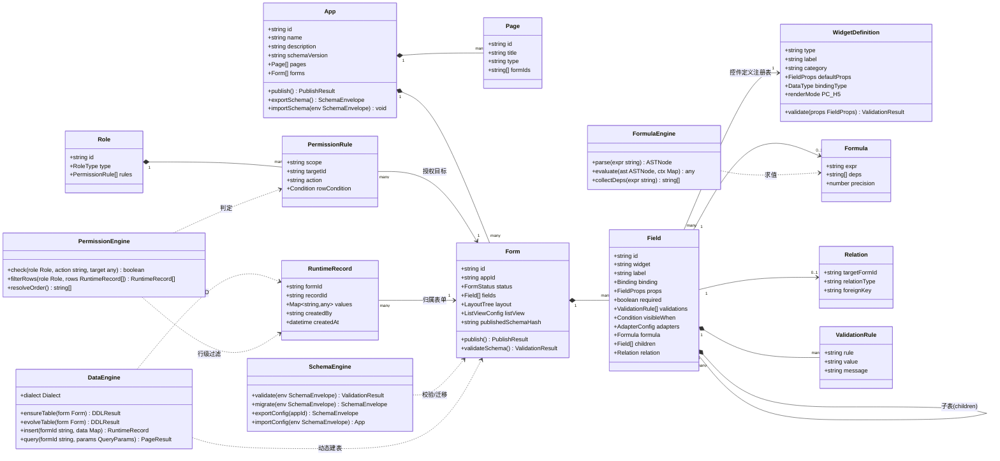
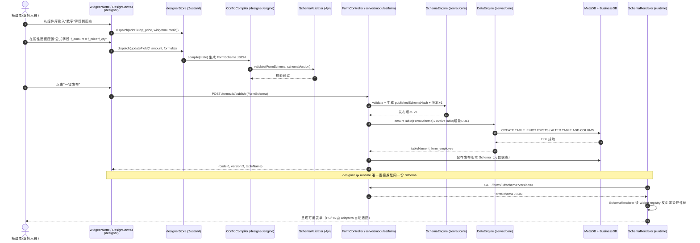
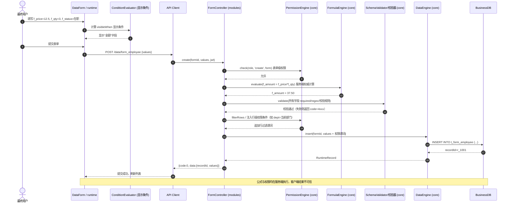
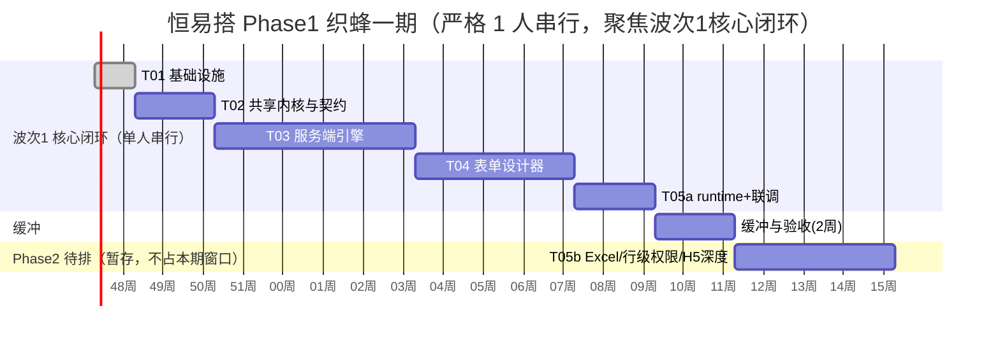

# 恒易搭（HengYiDa）· 系统架构设计与开发计划

| 项目 | 内容 |
| --- | --- |
| 文档类型 | 系统架构设计 + 任务分解 + 里程碑排期（**本阶段仅设计，不编写业务代码**） |
| 上游输入 | 产品经理许清楚《恒易搭 MVP 产品需求文档 v1.0》 + 原始需求描述纯文本 |
| 架构负责人 | 高见远（Gao）· 软件架构师 · 团队 software-hengyida |
| 内部代号 | 织蜂（zhifeng / weaver） |
| 文档版本 | **v1.3（单人基准版）**——基于 v1.2 增量更新，投入确认为严格 1 人，波次2 暂存 Phase 2 |
| 锁定日期 | 2026-11-23 |
| 决策状态 | **技术选型、交付口径与 VI 视觉规范均已锁定，不再评估替代方案**（详见第 1 节、第 8 节） |
| VI 规范 | 《恒信 VI 视觉识别系统手册》V1.1（2026-11）——单一深蓝色系，基石深蓝 #1B3D73，原创 H·X 蜜蜂标志 |
| 目标范围 | Phase 1 聚焦核心闭环（锁定 3 个月 = 12 周 + 2 周缓冲），后续按需扩展；Phase 2-4 给出粗粒度路线 |
| 硬性约束 | 完全原创；不模仿任何现有低代码产品；不基于开源低代码框架二次修改；严格执行原始需求文档目录规范 |

---

## 0. 设计总纲（Executive Summary）

恒易搭的技术本质是「**配置驱动的表单/数据运行平台**」。整套系统围绕一份**原创的应用配置 JSON Schema** 运转：

- **designer（设计器）** 把用户的拖拽操作编译成 Schema；
- **runtime（运行端）** 把 Schema 反向渲染成可用页面；
- **server/core（服务端核心引擎）** 负责把 Schema 翻译为动态表结构（DDL）、执行公式/校验/权限，并提供全功能 REST API；
- **shared（共享层）** 让前后端共用同一套控件定义、类型与常量，保证「一次配置、两端一致、双模部署」。

一句话架构公式：

> **恒易搭 = 一份 Schema + 三个消费者（designer / runtime / server-core）+ 两个部署形态（SaaS / 私有化，仅配置切换）**

本设计严格遵守原始需求第 4 节的目录规范，所有新增文件都落在既定目录树内，仅做必要补充（如为 Monorepo 包补充 `package.json`），不改动顶层职责划分。

---

## 1. 实现方案与框架选型结论

### 1.1 核心技术挑战（先认清难点，再选框架）

| 挑战 | 说明 | 对选型的约束 |
| --- | --- | --- |
| C1 配置与渲染双向契约 | 控件既要能在设计器里"画出来"，又要能在运行端"渲染出来"，且属性面板能反向编辑 | 需要**前后端共享的控件定义注册表**和强类型 Schema，语言需统一类型系统 |
| C2 动态表结构 | 用户搭的表单在运行时自动建表/改表，且需支持未来换数据库 | 需要 **query builder + 方言抽象层**，而非编译期 ORM |
| C3 公式与显示条件求值 | 金额=单价×数量，且表达式来自用户，不可信任 | 需要**受限 AST 表达式引擎**，禁止任意代码执行 |
| C4 三层权限判定 | 应用级 / 表单级 / 行级，且判定顺序影响正确性与性能 | 需要独立的**权限引擎**，规则可配置、判定顺序可预测 |
| C5 原创交互与高性能拖拽 | 拖拽 ≥50FPS，且交互路径/面板布局不得抄袭现有产品 | 需要**底层通用 DnD 能力 + 100% 自研交互层** |
| C6 一套代码双模部署 | SaaS 与私有化功能一致，仅配置切换 | 需要 **deploy 配置层 + 环境变量注入**，业务逻辑零分支 |
| C7 PC 一次配置 H5 自动适配 | 不单独为手机重做设计 | 需要**响应式控件定义**（每个控件声明 pc/h5 渲染策略） |

### 1.2 选型结论总表（🔒 已锁定，不再评估替代方案）

> 以下选型已于 2026-11-23 由用户拍板锁定，工程师按此直接开工，不再进行 Vue / 数据库 / 部署形态的对比评估。

| 层面 | 锁定选型 | 关键理由 |
| --- | --- | --- |
| 前端框架 | 🔒 **Vite + React 18 + TypeScript** | React 组件模型与"控件定义→反向渲染"契约天然契合；TS 让 shared 类型贯通前后端，是 C1 的前置条件；Vite 冷启动快、生态成熟。**不再评估 Vue** |
| UI 组件 | 🔒 **MUI 5 + Tailwind CSS 3** | MUI 提供企业级可访问组件底座，Tailwind 承载原创视觉基线（VI 已定稿，令牌见 `packages/shared/constants/brand.ts`：单一深蓝色系 #1B3D73/#E8EFF8/#9AA4B2）与响应式（C7），二者结合可彻底摆脱现有低代码产品的视觉风格 |
| 拖拽能力 | 🔒 **@dnd-kit/core**（底层能力）+ **100% 自研交互层** | @dnd-kit 是无低代码绑定的通用 DnD 库，性能好、可定制；**交互路径、控件面板布局、画布逻辑全部自研**，满足原创红线（C5） |
| 设计器状态 | 🔒 **Zustand** | 轻量、适合维护设计器的配置状态树，避免 Redux 样板代码 |
| 后端框架 | 🔒 **Node.js + NestJS + TypeScript** | 全栈 TS 统一，shared 包可直接被 server 引用（C1）；NestJS 的 Module/Provider 天然映射 server/modules 与 server/core 分层；对"1 名全栈"团队最友好 |
| 数据库访问 | 🔒 **Knex.js（query builder）+ 方言抽象层** | 动态 DDL 需在运行时拼装 CREATE/ALTER TABLE，编译期 ORM（Prisma/TypeORM）不擅长；Knex 原生支持多数据库方言，是 C2/C6 的关键 |
| 数据库 | 🔒 **MySQL 8.0（一期唯一实现与测试目标）** | 生态成熟、私有化客户接受度最高、支持在线 DDL 与 JSON 字段。**方言抽象层保留 PostgreSQL / SQL Server 切换能力，但一期只实现并只测 MySQL 矩阵** |
| 公式引擎 | 🔒 **自研受限 AST 引擎（jsep 解析 + 白名单求值）** | jsep 仅做表达式解析（非低代码框架），求值器由我们自研，运算符/函数白名单 + 字段 ID 映射，杜绝注入（C3）。一期公式聚焦四则运算，高级函数按需扩展 |
| Schema 校验 | 🔒 **Ajv（JSON Schema 校验）** | 配置 JSON 导入导出（R-002）需要严格校验与版本兼容；Ajv 是通用校验器，非低代码框架 |
| API 规范 | 🔒 **REST + OpenAPI 3.0（NestJS Swagger 自动生成）** | 全功能 API 化（R-017），文档与代码同步 |
| Excel | 🔒 **SheetJS（xlsx）**（波次2 交付） | 数据导入导出（R-012），成熟稳定；按两波次排期归入波次2 |
| 部署 | 🔒 **一期：本地可运行为主 + SaaS 底座预留，仅 Docker Compose 基础容器化** | 保留 `DeployMode` 配置切换能力，SaaS 与私有化功能一致；**K8s 集群、租户计费、私有化一键交付包明确推至 Phase 3** |
| 认证授权 | 🔒 **JWT（登录态）+ 自研 RBAC/行级规则引擎** | 三类角色与三级权限（R-008/R-013~R-015），规则完全自主设计（架构原创红线） |

### 1.3 对 PRD 默认技术栈的"确认与锁定"

PRD 建议 Vite + React + TS + MUI + Tailwind，本设计**完全采纳并锁定**，补充两点强化理由：
1. **类型贯通是可维护性的核心**：designer / runtime / server 共享 TS 类型，是"designer 与 runtime 共享控件定义"这一硬要求的工程化保障。Q2 已锁定 **React + TypeScript**，不再评估 Vue。
2. **不基于任何开源低代码框架**：本设计选用的均为**通用基础库**（DnD、表达式解析、Schema 校验、query builder、UI 组件），不含 Formily / amis / Retool / Appsmith 等低代码/表单框架，满足"架构原创、可溯源"。

### 1.4 架构模式

- 前端：**组件化 + 领域驱动的配置状态管理**（Monorepo + Workspace）。
- 后端：**分层架构 + 六边形思想**——`modules`（业务编排，用例层）→ `core`（纯领域引擎，不依赖具体数据库/框架）→ 基础设施（Knex/DB/文件存储）。依赖方向单向向内，保证"换数据库/换部署方式不影响业务逻辑"（原始需求第 4 节目录设计原则）。
- 全局：**Schema 驱动（Schema-Driven Development）**——配置即单一事实来源（Single Source of Truth）。

### 1.5 部署模式与交付边界（🔒 已锁定）

| 范围 | 一期（Phase 1）是否交付 | 说明 |
| --- | --- | --- |
| 本地可运行 + Docker Compose 基础容器化 | ✅ 交付 | 一期以"本地可运行为主"，提供应用 + MySQL 的 Compose 基础编排 |
| SaaS 底座预留 | ✅ 仅预留能力 | 保留 `DeployMode`（DEPLOY_MODE=saas\|private）+ 环境变量配置切换能力，两模式功能一致；不交付完整 SaaS 运营功能 |
| K8s 集群编排 | ❌ 推至 Phase 3 | `deployments/saas/k8s/` 一期仅建占位，不实现 |
| SaaS 租户管理与计费 | ❌ 推至 Phase 3 | 归 P3-A |
| 私有化一键交付包 | ❌ 推至 Phase 3 | 归 P3-B，一期仅基础 Compose |
| 加密存储 / HTTPS | ❌ 推至 Phase 3 | 归 P3-C |

> 精简原则：一期只在 `server/deploy/` 固化配置切换契约，业务代码保持零部署分支； Phase 3 在该契约下填充具体编排，无需改动 modules/core。

---

## 2. 文件清单（严格遵循原始需求目录规范）

> 说明：以下清单**完整保留**原始需求第 4 节的目录与职责，仅在既定目录内填充 Phase 1 所需文件。带 `[Phase2+]` 标记的 files 属后续阶段，Phase1 不实现。`shared/` 下补充 `package.json` 是因 Monorepo workspace 包管理需要，不改变其"前后端共享"职责。

```text
hengyida/                                          # 项目根目录（产品名：恒易搭）
├── README.md                                      # 项目说明、快速启动、目录导航
├── package.json                                   # Monorepo 根配置 + workspace + 脚本
├── pnpm-workspace.yaml                            # pnpm workspace 声明（packages/*）
├── tsconfig.base.json                             # 全局 TS 基础配置（路径别名 @hengyida/*）
├── turbo.json                                     # 构建任务编排（build/test/lint 缓存）
├── .env.example                                   # 环境变量样例（DEPLOY_MODE、DB 连接等）
│
├── docs/
│   ├── prd/
│   │   └── HengYiDa-PRD-v1.0.md                   # 产品需求文档（本次上游输入归档）
│   ├── design/
│   │   ├── ARCHITECTURE.md                        # 【本文件】系统架构设计与开发计划
│   │   ├── class-diagram.mermaid                  # 核心实体类图（本文第 3 节提取）
│   │   ├── sequence-diagram.mermaid               # 关键时序图（本文第 4 节提取）
│   │   ├── originality-checklist.md               # 原创性自查机制与设计决策留痕
│   │   └── brand/
│   │       └── visual-baseline.md                 # 原创视觉基线（VI 手册 V1.1 已定稿：单一深蓝色系、H·X 蜜蜂标志、思源黑体；令牌见 shared/constants/brand.ts）
│   └── api/
│       └── openapi-v1.yaml                        # OpenAPI 3.0 接口契约（由 NestJS Swagger 同步）
│
├── packages/
│   ├── designer/                                  # 设计器模块（拖拽搭建界面，面向搭建者）
│   │   ├── package.json
│   │   └── src/
│   │       ├── components/                        # 设计器自身组件
│   │       │   ├── WidgetPalette.tsx              # 左：原创控件库面板（分组/搜索/拖入）
│   │       │   ├── DesignCanvas.tsx               # 中：画布（拖放、选中、排序、嵌套）
│   │       │   ├── PropertyPanel.tsx              # 右：字段属性/校验/显示条件/公式配置
│   │       │   ├── PreviewSwitcher.tsx            # PC/H5 预览切换（调用共享控件注册表）
│   │       │   └── PublishBar.tsx                 # 顶：一键发布入口
│   │       ├── engine/                            # 搭建引擎（解析配置、渲染页面）
│   │       │   ├── DragDropController.ts          # 拖拽编排（基于 @dnd-kit 的自研交互）
│   │       │   ├── ConfigCompiler.ts              # 拖拽状态 → 应用配置 JSON Schema
│   │       │   ├── ReverseRenderer.tsx            # Schema → 设计态控件（与 runtime 共用注册表）
│   │       │   └── SchemaValidator.ts             # 发布前本地 Ajv 校验
│   │       ├── store/
│   │       │   └── designerStore.ts               # Zustand 配置状态树 + 撤销/重做
│   │       ├── utils/
│   │       │   └── id.ts                          # 字段/控件稳定 ID 生成
│   │       └── main.tsx                           # 设计器应用入口
│   │
│   ├── runtime/                                   # 运行模块（用户实际使用系统的前端）
│   │   ├── package.json
│   │   └── src/
│   │       ├── renderer/                          # 根据配置渲染页面的核心
│   │       │   ├── SchemaRenderer.tsx             # Schema → 控件树（designer/runtime 共享契约的落地）
│   │       │   ├── PageRenderer.tsx               # 表单页 / 数据列表页渲染
│   │       │   └── ConditionEvaluator.ts          # 显示条件求值（复用 shared 公式引擎）
│   │       ├── components/                        # 运行时控件（与 designer 控件定义一一对应）
│   │       │   ├── controls/                      # 文本/数字/日期/下拉/附件/子表/关联表/公式
│   │       │   ├── DataList.tsx                   # 数据列表（筛选/排序/分页）
│   │       │   └── DataForm.tsx                   # 填报表单容器
│   │       ├── adapters/                          # 多端适配（PC/H5；小程序 [Phase2]）
│   │       │   ├── AdapterContext.ts              # 端能力抽象（布局栅格/触控/尺寸策略）
│   │       │   ├── PcAdapter.tsx
│   │       │   └── H5Adapter.tsx
│   │       ├── api/
│   │       │   └── client.ts                      # 统一 API 客户端（错误码、Schema 版本头）
│   │       └── main.tsx                           # 运行端应用入口
│   │
│   ├── server/                                    # 后端服务（Node.js + NestJS + TS）
│   │   ├── package.json
│   │   └── src/
│   │       ├── main.ts                            # NestJS 启动入口（加载 deploy 配置）
│   │       ├── modules/                           # 业务模块（用例编排层）
│   │       │   ├── app/                           # 应用管理（R-001）
│   │       │   ├── form/                          # 表单/发布/Schema 导入导出（R-002~R-009）
│   │       │   ├── data/                          # 数据 CRUD/列表/Excel（R-011/R-012）
│   │       │   ├── auth/                          # 登录/JWT/三类角色（R-014）
│   │       │   └── permission/                    # 应用级/表单级/行级权限配置（R-013/R-015）
│   │       ├── core/                              # 核心引擎（纯领域，不依赖具体 DB/部署方式）
│   │       │   ├── schema-engine/                 # 配置 Schema 校验、版本迁移、导入导出
│   │       │   ├── data-engine/                   # 动态 DDL/DML + 方言抽象（MySQL/PG/SQL Server）
│   │       │   ├── formula-engine/                # 受限 AST 表达式解析与求值（R-005/R-008）
│   │       │   └── permission-engine/             # 三级权限判定规则（R-013~R-015）
│   │       ├── deploy/                            # 部署相关（SaaS/私有化模式切换）
│   │       │   ├── DeployMode.ts                  # DEPLOY_MODE=saas|private 能力开关
│   │       │   ├── config.saas.ts
│   │       │   └── config.private.ts
│   │       └── common/                            # 统一响应/异常/拦截器
│   │           ├── ResponseInterceptor.ts         # {code,data,message} 统一封装
│   │           └── AllExceptionsFilter.ts
│   │
│   └── shared/                                    # 前后端共享（类型定义、常量、工具函数）
│       ├── package.json                           # 作为 @hengyida/shared workspace 包被引用
│       ├── types/
│       │   ├── app.ts                             # App / Page 类型
│       │   ├── form.ts                            # FormSchema（表单配置 Schema）
│       │   ├── field.ts                           # FieldSchema / 控件属性 / 校验 / 显示条件
│       │   ├── permission.ts                      # Role / PermissionRule 类型
│       │   ├── data.ts                            # RuntimeRecord / 查询参数类型
│       │   └── schema.ts                          # SchemaVersion / 元信息 / JSON Schema 定义
│       ├── constants/
│       │   ├── widget-registry.ts                 # 【关键】控件定义注册表（designer/runtime 共享契约）
│       │   ├── error-codes.ts                     # 统一错误码
│       │   └── schema-version.ts                  # Schema 版本常量
│       └── utils/
│           └── formula-ast.ts                     # 表达式解析/求值的共享内核（前后端同源）
│
├── deployments/                                   # 部署配置（同一套代码，仅配置不同）
│   ├── saas/
│   │   ├── Dockerfile                             # 统一应用镜像
│   │   └── k8s/                                   # [Phase3] K8s 清单
│   └── private/
│       ├── docker-compose.yml                     # 私有化基础编排（应用 + MySQL）
│       └── .env.private.example
│
├── scripts/
│   ├── build.sh                                   # 全量构建编排
│   ├── dev.sh                                     # 本地开发启动
│   └── migrate.sh                                 # Schema 版本迁移辅助
│
└── tests/
    ├── unit/                                      # 公式引擎/权限引擎/Schema 校验单测
    ├── integration/                               # API 集成测试（动态建表、发布链路）
    └── e2e/                                       # 搭建→发布→填报端到端（Playwright）
```

### 2.1 三大目录设计原则的落地方式

| 原始原则 | 落地机制 | 关键文件 |
| --- | --- | --- |
| **designer 与 runtime 完全分离，通过同一套配置 JSON 连接** | 二者互不 import 对方代码；唯一耦合点是 `@hengyida/shared` 的 `FormSchema` 类型与 `widget-registry` 控件注册表。designer 产出 Schema，runtime 消费 Schema | `shared/types/form.ts`、`shared/constants/widget-registry.ts`、`designer/engine/ConfigCompiler.ts`、`runtime/renderer/SchemaRenderer.tsx` |
| **server/core 放引擎核心，换数据库/部署方式不影响业务** | `modules` 只依赖 `core` 的抽象接口；`data-engine` 内封装方言适配器（Dialect），Knex 实例注入。业务代码不出现任何 SQL 方言 | `server/core/data-engine/*`、`server/modules/*` |
| **deployments 独立，SaaS 与私有化同代码仅配置不同** | 所有模式差异收敛到 `DeployMode` + 环境变量（DEPLOY_MODE/DB_*/STORAGE_*），`modules/core` 零 `if(saas)` 分支 | `server/deploy/*`、`deployments/saas/*`、`deployments/private/*` |

---

## 3. 核心数据结构与接口

### 3.1 JSON Schema 约定（原创数据模型）

所有配置统一遵循 `SchemaEnvelope` 信封结构，`schemaVersion` 为强制字段，用于导入导出与版本迁移（R-002 / 风险 R11）：

```jsonc
// SchemaEnvelope —— 一切可迁移配置的顶层信封
{
  "schemaVersion": "1.0.0",        // 语义化版本，迁移依据
  "kind": "app" | "form",          // 配置类型
  "id": "app_xxx",                 // 稳定唯一 ID（跨环境保持一致）
  "meta": { "name": "人事管理", "description": "...", "exportedAt": "ISO8601" },
  "payload": { /* AppSchema 或 FormSchema */ }
}
```

**FormSchema（表单配置，designer 与 runtime 的共同契约）**：

```jsonc
{
  "schemaVersion": "1.0.0",
  "kind": "form",
  "id": "form_employee",
  "fields": [
    {
      "id": "f_name",              // 稳定 ID，数据列名的映射依据
      "widget": "text",            // 指向 widget-registry 的控件 type
      "label": "姓名",
      "binding": { "column": "f_name", "dataType": "varchar" },
      "props": { "placeholder": "请输入", "maxLength": 50 },
      "required": true,
      "defaultValue": null,
      "validations": [ { "rule": "regex", "value": "^[\\u4e00-\\u9fa5]{2,10}$", "message": "2-10个汉字" } ],
      "visibleWhen": { "expr": "f_status == '在职'", "deps": ["f_status"] },  // 显示条件
      "adapters": { "h5": { "span": 24 }, "pc": { "span": 12 } },              // 多端适配声明
      "children": [],              // 子表字段（一对多）
      "relation": null             // 关联表配置（多对一）
    },
    {
      "id": "f_amount",
      "widget": "formula",
      "label": "金额",
      "binding": { "column": "f_amount", "dataType": "decimal" },
      "formula": { "expr": "f_price * f_qty", "deps": ["f_price", "f_qty"], "precision": 2 }
    }
  ],
  "layout": { "pc": [...], "h5": [...] },        // 布局树（控件 id 的组织）
  "listView": { "columns": ["f_name", "f_amount"], "filters": [], "sort": [], "pageSize": 20 }
}
```

> 设计要点：**字段以稳定 `id` 为锚点**，数据表的物理列名即 `binding.column`（由 id 派生）。这样重命名标签不影响已存数据，是"配置与数据分离"原则的基石（见第 7 节）。

### 3.2 核心实体类图（Mermaid classDiagram）



### 3.3 主要 API 分组与示例（REST 风格）

统一响应格式：`{ "code": 0, "data": {...}, "message": "ok" }`；`code != 0` 为业务错误（错误码见第 7 节）。所有请求头携带 `X-Schema-Version`（当前 `1.0.0`）。

| 分组 | 方法 & 路径 | 说明 | 对应需求 |
| --- | --- | --- | --- |
| 应用 | `POST /api/v1/apps` | 创建应用 | R-001 |
| 应用 | `GET /api/v1/apps` / `GET /:id` | 列表 / 详情 | R-001 |
| 配置 | `POST /api/v1/apps/:id/export` | 导出配置 JSON | R-002 |
| 配置 | `POST /api/v1/apps/import` | 导入配置 JSON（含版本迁移） | R-002 |
| 表单 | `POST /api/v1/apps/:id/forms` | 创建表单 | R-003 |
| 表单 | `PUT /api/v1/forms/:id/schema` | 保存表单 Schema（草稿） | R-003~R-008 |
| 表单 | `POST /api/v1/forms/:id/validate` | 发布前校验（Ajv） | R-017 |
| 表单 | `POST /api/v1/forms/:id/publish` | **一键发布**（触发自动建表 + 生成运行时版本） | R-009 / R-010 |
| 数据 | `GET /api/v1/data/:formKey` | 列表（filter/sort/page 查询参数） | R-011 / R-013 |
| 数据 | `POST /api/v1/data/:formKey` | 新增（服务端公式计算 + 校验 + 权限） | R-005/R-008/R-013 |
| 数据 | `PUT|DELETE /api/v1/data/:formKey/:recordId` | 更新 / 删除 | R-011 |
| 数据 | `POST /api/v1/data/:formKey/import` | Excel 导入 | R-012 |
| 数据 | `GET /api/v1/data/:formKey/export` | Excel 导出 | R-012 |
| 权限 | `GET|POST /api/v1/roles` | 角色（管理员/编辑者/查看者） | R-014 |
| 权限 | `PUT /api/v1/permissions/:roleId` | 应用级/表单级/行级规则配置 | R-013/R-015 |
| 认证 | `POST /api/v1/auth/login` | 登录签发 JWT | R-014 |

示例 —— 一键发布：

```http
POST /api/v1/forms/form_employee/publish
Authorization: Bearer <jwt>
X-Schema-Version: 1.0.0
```
```json
// 200 响应
{ "code": 0, "message": "ok",
  "data": { "formId": "form_employee", "version": 3, "tableName": "t_form_employee",
            "ddl": "CREATE TABLE IF NOT EXISTS ...", "publishedAt": "2026-11-23T10:00:00Z" } }
```

示例 —— 数据填报（服务端执行公式 + 校验 + 行级权限后落库）：

```http
POST /api/v1/data/form_employee
Authorization: Bearer <jwt>
Content-Type: application/json
```
```json
{ "values": { "f_name": "张三", "f_price": 12.5, "f_qty": 3, "f_status": "在职" } }
```
```json
// 200 响应：f_amount 由服务端公式引擎计算为 37.50，非信任客户端
{ "code": 0, "message": "ok",
  "data": { "recordId": "r_1001", "values": { "f_amount": 37.50, "...": "..." } } }
```

---

### 3.4 数据库与容器化联调（Phase 1 落地补充）

一期唯一数据库实现为 **MySQL 8.0**，数据库全部容器化，不以本机安装的服务为前提。部署拓扑与连接约定如下：

| 项 | 约定 |
| --- | --- |
| 编排入口 | 根目录 `docker-compose.yml` 通过 `include` 复用 `deployments/private/docker-compose.yml`，项目名固定 `hengyida-private`，保证两种启动方式共用同一命名卷 |
| 镜像与存储 | `mysql:8.0`；命名卷 `mysql-data:/var/lib/mysql`；`127.0.0.1:${MYSQL_HOST_PORT:-3306}:3306`（仅绑定回环，冲突时宿主改 3307 并同步根 `.env` 的 `DB_PORT`） |
| 健康检查 | `mysqladmin ping -h 127.0.0.1 -u root --password="$$MYSQL_ROOT_PASSWORD" --silent`；`server` 通过 `depends_on.condition: service_healthy` 等待，密码在容器内展开，不落明文 |
| 连接主机 | **容器内**：`DB_HOST=mysql`（compose 服务名）；**宿主机调试**：`DB_HOST=127.0.0.1`（根 `.env`）。二者指向同一实例，仅网络路径不同 |
| 凭据管理 | `deployments/private/.env` 提供 `MYSQL_ROOT_PASSWORD` / `MYSQL_DATABASE` / `MYSQL_USER` / `MYSQL_PASSWORD` / `JWT_SECRET`；compose 仅写 `${VAR}` 插值；样例文件只含占位符，真实 `.env` 已由 `.gitignore` 忽略。轮换入口 `pnpm run secrets:rotate` 同步两个 `.env` 与数据库账号，备份为被忽略的 `.env.bak-*` |
| 备份与恢复 | `mysql-backup` sidecar 每日 `mysqldump` 业务库至 `backups/*.sql.gz`，保留 `BACKUP_RETENTION_DAYS`（默认 7）天；`pnpm run backup:once` 手动触发。卷损坏/误删表/整库丢失的恢复步骤与演练记录见 `docs/DISASTER-RECOVERY.md` |

表结构分两层，与「配置与数据分离」原则一致：

1. **元数据表（基线）**：`meta_apps`、`meta_forms`、`meta_policies`、`meta_users`。由 `pnpm run migrate`（`scripts/migrate.mjs`）幂等建库建表；各 `Service.onModuleInit` 亦会幂等补建，二者不冲突。
2. **业务动态表**：`t_form_<formId>`（formId 的 `form_` 前缀会被 `MySQLDialect.tableName` 去掉）。表单发布时由 `DataEngine.ensureTable/evolveTable` 创建或增量加列，DDL 一律 `CREATE TABLE IF NOT EXISTS` / `ALTER TABLE ... ADD COLUMN`，**只增不删**，不重建表。

联调验证入口：

```bash
docker compose up -d && pnpm run migrate
pnpm run dev:server          # 宿主机 127.0.0.1
pnpm run e2e:chain           # 搭建→发布→自动建表→填报→渲染，含 information_schema 物理表核验
```

### 3.5 多环境、CI 与可观测性（P2/P3 落地补充）

| 环境 | 编排入口 | 项目名 / 命名卷 | 宿主端口（MySQL / Server） | 加固 |
| --- | --- | --- | --- | --- |
| 本地联调 | 根 `docker-compose.yml` → `deployments/private/` | `hengyida-private` / `mysql-data` | 3306 / 3000 | 凭据本地插值、仅绑定回环 |
| dev | `deployments/dev/docker-compose.yml` | `hengyida-dev` / `mysql-data-dev` | 3306 / 3000 | `LOG_LEVEL=debug` |
| staging | `deployments/staging/docker-compose.yml` | `hengyida-staging` / `mysql-data-staging` | 3307 / 3001 | 近似生产配置、`LOG_LEVEL=info` |
| prod | `deployments/prod/docker-compose.yml` | `hengyida-prod` / `mysql-data-prod` | 3308 / 3002 | `read_only: true` + `tmpfs`、CPU/内存限额、`restart: always`、`no-new-privileges` |

三套环境的本地 `.env` 均被 `.gitignore` 忽略，样例仅含占位符；`pnpm run compose:check` 可一次校验四套编排。

CI 采用双平台同构门禁：GitHub Actions（`.github/workflows/ci.yml`）与 GitLab CI（`.gitlab-ci.yml`）均在 PR/MR 与主干触发 `pnpm run typecheck` → `pnpm test` → `docker compose config -q`，CI 使用占位凭据，不依赖真实 `.env`。

可观测性采用 **pino** 结构化 JSON 日志（含 `pino-http` 请求日志），`Authorization` / Cookie / 密码 / JWT 字段统一脱敏。根路径 `GET /healthz` 绕过 `/api` 前缀与响应包装，返回 DB ping、版本、部署模式与运行时长，DB 异常返回 503；server 容器 healthcheck 直接复用该端点。

---

## 4. 程序调用流程（Mermaid 时序图）

### 4.1 流程一：拖拽字段 → 配置 → 发布 → 自动建表 → runtime 渲染



### 4.2 流程二：用户填报 → 公式计算 → 校验 → 行级权限过滤 → 落库



---

## 5. 有序任务列表

### 5.1 Phase 1（织蜂一期）任务分解 —— 覆盖全部 P0（R-001 ~ R-020）

> 依据任务分解硬约束：**不超过 5 个任务**、按功能模块/层次分组、首任务为项目基础设施、每任务≥3 个文件。粒度到"工程师可直接开工"。

| ID | 任务名称 | 主要源文件（相对路径） | 依赖 | 预估人日 | 优先级 |
| --- | --- | --- | --- | --- | --- |
| **T01** | **项目基础设施与 Monorepo 脚手架** | `package.json`、`pnpm-workspace.yaml`、`turbo.json`、`tsconfig.base.json`、`.env.example`、`README.md`、`packages/*/package.json`、`scripts/build.sh`、`scripts/dev.sh` | — | 8 | P0 |
| **T02** | **共享内核与控件契约（Schema 类型系统 + 控件注册表 + 公式 AST + 权限模型）** | `shared/types/{app,form,field,permission,data,schema}.ts`、`shared/constants/{widget-registry,error-codes,schema-version}.ts`、`shared/utils/formula-ast.ts`、`docs/api/openapi-v1.yaml`、`docs/design/originality-checklist.md` | T01 | 15 | P0 |
| **T03** | **服务端引擎与业务模块（动态建表 + 公式/校验/权限引擎 + 全功能 API）** | `server/src/main.ts`、`server/src/core/{schema-engine,data-engine,formula-engine,permission-engine}/*`、`server/src/modules/{app,form,data,auth,permission}/*`、`server/src/deploy/*`、`server/src/common/*` | T02 | 35 | P0 |
| **T04** | **表单设计器（原创拖拽交互 + 配置编译 + 反向渲染 + 属性/公式配置 + 一键发布）** | `designer/src/components/{WidgetPalette,DesignCanvas,PropertyPanel,PreviewSwitcher,PublishBar}.tsx`、`designer/src/engine/{DragDropController,ConfigCompiler,ReverseRenderer,SchemaValidator}.*`、`designer/src/store/designerStore.ts`、`designer/src/utils/id.ts`、`designer/src/main.tsx` | T02 | 30 | P0 |
| **T05** | **Runtime 渲染 + 多端适配 + 集成联调 + 容器化与非功能验收** | `runtime/src/renderer/*`、`runtime/src/components/*`、`runtime/src/adapters/*`、`runtime/src/api/client.ts`、`runtime/src/main.tsx`、`deployments/{saas,private}/*`、`tests/{unit,integration,e2e}/*` | T03, T04 | 25 | P0 |

**Phase1 合计约 113 人日**（含各任务内自测；跨任务联调与项目管理另计，见第 8 节总测算 ~125 人日）。

> 🔒 **决策锁定后的一期两波次划分**：锁定 3 个月（12 周 + 2 周缓冲），一期按"核心闭环优先、增强项兜底"分两波交付（详细排期见第 8.4 节）。
> - **波次 1 · 核心闭环（约 8 周，必须交付）**：T01 脚手架 → T02 共享内核与控件契约 → T03 服务端引擎（动态建表 / 公式四则 / 校验 / 应用级与表单级权限 / 全功能 API）→ T04 设计器（拖拽 / 字段配置 / 子表 / 关联表 / 公式四则 / 一键发布）→ T05 中的 runtime 渲染与基础 H5 适配、端到端联调。
> - **波次 2 · 增强项（约 4 周 + 2 周缓冲）**：Excel 导入导出、行级权限细化、H5 触控深度优化、性能与非功能验收、Docker Compose 容器化、原创性留痕与文档收尾。
> - **明确不在一期**：微信小程序、流程引擎（均 Phase 2）；K8s 集群、SaaS 租户计费、私有化一键交付包（均 Phase 3）。

**任务开工级细化说明（摘录关键子项，工程师可直接对照）**：

- T02 关键交付物：
  1. `widget-registry.ts` 实现**控件定义注册表**（type → 默认属性、绑定类型、PC/H5 renderMode、校验器），作为 designer/runtime 共享反向渲染契约；
  2. `formula-ast.ts` 实现 **jsep 解析 + 白名单 AST 求值器**（运算符/函数白名单、字段 id 映射、无代码执行）；
  3. `schema.ts` 定义 `SchemaEnvelope` 与 Ajv 校验用 JSON Schema，`schema-version.ts` 固化版本与迁移钩子。
- T03 关键交付物：
  1. `data-engine` 实现 **Dialect 接口 + MySQLDialect**，运行时 `ensureTable/evolveTable` 生成幂等 DDL（CREATE TABLE IF NOT EXISTS / ALTER ADD COLUMN）；
  2. `permission-engine` 实现**三级权限判定顺序**（见第 7 节），行级权限转为查询谓词注入；
  3. `form` 模块 `publish` 用例串起"校验→版本+1→DDL→保存 Schema"，`common` 落地 `{code,data,message}` 与错误码。
- T04 关键交付物：
  1. `DragDropController` 基于 @dnd-kit 实现**原创拖放交互**（面板布局/操作路径自研，留痕到 originality-checklist.md）；
  2. `ConfigCompiler` 把设计态编译为 FormSchema，`ReverseRenderer` 消费**同一份 widget-registry** 保证与 runtime 一致；
  3. `PropertyPanel` 支持子表/关联表/公式字段属性编辑，`SchemaValidator` 发布前校验。
- T05 关键交付物：
  1. `SchemaRenderer` 按 Schema + widget-registry 渲染控件树，`PcAdapter/H5Adapter` 实现一次配置双端适配；
  2. 数据填报走服务端公式/校验/权限链路，Excel 导入导出；
  3. Docker/Compose 基础镜像 + 三类测试（单测/集成/E2E）+ 非功能验收（首屏<2s、拖拽≥50FPS）。

### 5.2 Phase 2-4 粗粒度任务（路线图，不在本期 5 任务内）

| 阶段 | 粗粒度任务 | 说明 |
| --- | --- | --- |
| **Phase 2**（1-2 月，🔒 已锁定不提前） | P2-A 流程引擎（可视化审批流：条件分支/会签/转交/表单绑定）<br>P2-B 权限增强（字段级、数据范围模板）<br>P2-C 微信小程序（web-view 壳 + 独立小程序适配器） | 对应 R-021~R-023；新增 `server/src/core/flow-engine`、`runtime/src/adapters/MiniProgramAdapter`。**小程序与流程引擎明确不进一期** |
| **Phase 3**（1-2 月，🔒 已锁定） | P3-A SaaS 租户管理与计费<br>P3-B 私有化 Docker Compose 一键部署包<br>P3-C K8s 编排 + 加密存储 + HTTPS | 对应 R-024~R-026；填充 `deployments/saas/k8s` 与 `deployments/private`。一期仅保留部署切换契约，不实现上述三项 |
| **Phase 4**（持续） | P4-A 控件插件化扩展机制<br>P4-B 开放 API / 第三方集成<br>P4-C 模板市场 | 对应 R-027~R-028；控件注册表升级为可注册插件协议 |

---

## 6. 依赖包清单

### 6.1 前端（designer + runtime）

```text
react@^18.2.0 / react-dom@^18.2.0        # UI 框架
@mui/material@^5.14.0 / @emotion/react / @emotion/styled  # 企业级组件底座
tailwindcss@^3.4.0 / postcss / autoprefixer               # 原创视觉基线与响应式
@dnd-kit/core@^6.1.0 / @dnd-kit/sortable@^8.0.0           # 通用拖拽能力（非低代码框架）
zustand@^4.5.0                                            # 设计器配置状态树
ajv@^8.12.0                                               # JSON Schema 校验（前后端共享）
jsep@^1.3.0                                               # 表达式解析（共享内核）
xlsx@^0.18.5                                              # Excel 导入导出
axios@^1.6.0                                              # API 客户端
```

### 6.2 后端（server）

```text
@nestjs/core / @nestjs/common / @nestjs/platform-express@^10.x  # 后端框架
@nestjs/swagger / swagger-ui-express                           # OpenAPI 自动生成
@nestjs/config@^3.x                                            # 部署模式/环境变量
@jwt/... (@nestjs/jwt@^10.x, passport-jwt)                      # JWT 认证
knex@^3.1.0                                                    # query builder + 动态 DDL
mysql2@^3.6.0                                                  # MySQL 8.0 驱动（🔒 一期锁定）
pg / mssql                                                     # 方言预留（Phase1 不启用）
ajv@^8.12.0 / jsep@^1.3.0                                      # 与 shared 同源
class-validator / class-transformer                            # DTO 校验
```

### 6.3 测试

```text
vitest@^1.x                 # 单元/集成测试（TS 原生，快）
@playwright/test@^1.40.0    # E2E：搭建→发布→填报
@testing-library/react@^14  # 组件测试
supertest@^6.x              # API 集成测试
```

### 6.4 构建与工程

```text
typescript@^5.3.0 / vite@^5.0.0 / @vitejs/plugin-react@^4.2.0
turbo@^1.12.0               # Monorepo 任务编排与缓存
pnpm@^8.x                   # 包管理（workspace）
eslint / prettier           # 代码规范（含注释率>30% 检查辅助）
docker / docker-compose     # 容器化
```

---

## 7. 共享知识（跨文件约定，工程师必读）

1. **配置与数据分离**：Schema（配置）存于元数据表，`RuntimeRecord`（业务数据）存于动态业务表；字段以稳定 `id` 为锚点、物理列由 `binding.column` 派生。改标签不改数据；改字段类型走 `evolveTable` 增量 DDL，**严禁重建表丢数据**。
2. **命名规范**：目录/文件用 kebab-case 或 camelCase（仓库标识统一 `zhifeng`/`weaver`，避免中文路径）；字段 id 形如 `f_xxx`，表单 id `form_xxx`，应用 id `app_xxx`，数据表 `t_form_<formId>`；组件名 PascalCase。
3. **Schema 版本**：所有可迁移配置带 `schemaVersion`（语义化版本），请求头带 `X-Schema-Version`；导入时 `SchemaEngine.migrate` 逐级迁移，不兼容则明确报错而非静默覆盖。
4. **API 统一响应**：`{ code, data, message }`，`code=0` 成功；HTTP 状态码语义化（400 参数、401 未登录、403 无权限、404 不存在、500 内部）；错误码分段（见下）。
5. **错误码分段**：`1xxx` 通用/参数，`2xxx` 认证授权，`3xxx` 应用/表单配置，`4xxx` 数据校验，`5xxx` 动态 DDL/数据引擎。前端按 code 做统一提示映射。
6. **权限判定顺序（固定）**：`认证(JWT) → 应用级(是否可访问该 app) → 表单级(该角色对 form 的 CRUD 权限) → 行级(注入谓词过滤数据) → 字段级(Phase2)`。**先应用后表单后行级**，任何一级拒绝立即短路，保证正确性与性能。
7. **服务端权威计算**：公式求值、校验、权限过滤**必须在服务端执行**，客户端计算结果仅用于即时交互展示，不作为落库依据（防篡改）。
8. **公式安全**：表达式只经 jsep 解析为 AST，求值器仅放行白名单运算符与函数，字段引用解析为 `values[f_xxx]`；**禁止 eval / new Function / 原型链访问**。
9. **designer/runtime 解耦纪律**：二者不得相互 import；共享只能通过 `@hengyida/shared` 的类型与 `widget-registry`。新增控件必须**同时**在注册表登记，设计器与运行端自动获得一致渲染。
10. **原创性留痕**：每个交互/视觉决策记入 `docs/design/originality-checklist.md`（设计参照来源=self/original、决策理由、日期），设计评审时核查；禁止出现现有低代码产品的专有名词与布局截图。
11. **日期时间**：统一 ISO 8601 UTC 存储与传输，前端按本地时区展示。
12. **双模部署纪律**：业务代码禁止出现 SaaS/私有化分支；差异一律通过 `DeployMode` + 环境变量注入，`deployments/` 仅放配置。

---

## 8. 里程碑排期与人日换算（🔒 Phase1 锁定 3 个月 = 12 周 + 2 周缓冲）

> **🔒 v1.3 投入确认（2026-11-23）：实际投入为严格 1 名全栈工程师。** 排期模型正式切换为第 8.2 节**模型 A**——按 12 周 + 2 周缓冲基准，**聚焦波次 1 核心闭环**，波次 2 增强项（Excel / 行级权限细化 / H5 深度优化）暂存 Phase 2 待排。原模型 B（小团队并行）保留为对照，不再是基准。完整 P0 单人约 6.9 个月不可行，已在 8.2/9.2 固化裁剪与风险缓解。

### 8.1 Phase1 基准工作量

| 构成 | 人日 |
| --- | --- |
| T01 基础设施 | 8 |
| T02 共享内核与控件契约 | 15 |
| T03 服务端引擎与模块 | 35 |
| T04 设计器 | 30 |
| T05 runtime + 联调 + 容器化 | 25 |
| 跨任务联调 / 原创设计评审 / 文档 / QA 统筹 / 缓冲 | 12 |
| **Phase1 合计** | **约 125 人日** |

### 8.2 两种投入模型的可行性结论（🔒 v1.3：基准取模型 A）

**模型 A：严格 1 名全栈工程师（🔒 已确认实际投入，正式作为基准排期模型）**
- 有效产出按 18 人日/月（含沟通、调试、返工折扣）计：完整 125 人日 ÷ 18 ≈ **6.9 个月**。
- 结论：**无法在 12+2 周窗口内完成完整 P0 范围**，差距约 3-4 个月；必须裁剪范围。
- **🔒 锁定裁剪方案（单人基准）**：
  1. 砍/简：Excel 导入导出、子表高级校验、独立 H5 深度适配层（先用 CSS 响应式自动适配）、公式仅保留四则运算、行级权限模板化（按当前用户/部门，不做自定义规则编辑器）；
  2. 复用：仅做 8 个高频控件（文本/数字/日期/下拉/附件/子表/关联/公式），后续按插件机制补；
  3. **范围收缩到波次 1 核心闭环（约 45–65 人日）**，12 周开发聚焦搭建→发布→自动建表→填报→渲染主链路；**波次 2 全部增强项暂存 Phase 2 待排**（见第 9 节 R-单人风险）。
  4. 当实际为 1 人时，开发顺序按 T01 → T02 → T03 → T04 → T05a 串行推进（无并行），M2 核心闭环为唯一必须达成的硬门禁。

**模型 B：小团队（前端 1 + 后端 1 + 设计 0.5 + QA 0.5）——对照模型（不再是基准）**
- 有效产能按 2 名全职开发并行 ≈ 36 人日/月（设计/QA 为 0.5 当量，主要贡献在 T02 契约与 T05 验收，计入缓冲）。
- 关键路径：T01(8) → T02(15) → [T03(35) ∥ T04(30)] → T05(25)。前端做 T04、后端做 T03 可**并行**。
- 关键路径人日 ≈ 8 + 15 + max(35,30) + 25 = **83 人日**（开发并行后的日历人日），÷ 36 ≈ 2.3 个月，加上联调/设计评审/验收缓冲 ≈ **2.5-3 个月**。
- 结论：**可行**，与锁定的 3 个月窗口一致。按 12 周开发 + 2 周缓冲执行（见 8.3/8.4）。

### 8.3 推荐排期（🔒 v1.3：严格 1 人串行，12 周 + 2 周缓冲）



> 里程碑验收点（单人基准）：M1（第 3 周）Schema 契约冻结；**M2（第 12 周，波次1 末，唯一硬门禁）**设计器可产出 Schema、后端可自动建表、搭建→发布→自动建表→填报→渲染核心闭环打通、≥3 真实场景验证；M4（第 14 周）缓冲收尾。波次 2 增强项（T05b）为 **Phase 2 待排**，不占用本 12+2 周窗口。原小团队模型下第 8 周打通 M2 的并行口径不再适用。

### 8.4 🔒 锁定后一期两波次任务归属（对照第 5.1 节）

| 波次 | 周期 | 交付内容（任务归属） | 退出标准 |
| --- | --- | --- | --- |
| **波次 1 · 核心闭环** | 约 8 周 | **T01** 脚手架；**T02** 共享内核与控件契约；**T03** 服务端引擎（动态建表 / 公式四则 / 校验 / 应用级与表单级权限 / 全功能 API）；**T04** 设计器（拖拽 / 字段配置 / 子表 / 关联表 / 公式四则 / 一键发布）；**T05a** runtime 渲染 + 基础 H5 适配 + 端到端联调 | 一次搭建→发布→自动建表→填报→渲染全流程可用（M2） |
| **🔒 波次 2 · 暂存 Phase 2 待排**（单人基准） | 不占本期窗口 | **T05b** Excel 导入导出、行级权限细化、H5 触控深度优化、性能与非功能深度验收、Docker Compose 容器化增强、原创性留痕文档收尾 —— **因投入确认为严格 1 人，本波次全部暂存 Phase 2 待排**（见第 8.2 模型 A / 第 9 节 R-单人） | 待 Phase 2 排期后另行定义；本期不承诺 |
| **不在一期** | — | 微信小程序、流程引擎（Phase 2）；K8s 集群、SaaS 租户计费、私有化一键交付包（Phase 3） | — |

> 🔒 **v1.3 单人基准决策**：投入确认为严格 1 名全栈，按第 8.2 模型 A 裁剪——本期 12+2 周**只交付波次 1 核心闭环**（唯一硬门禁 M2），波次 2 增强项（Excel / 行级权限 / H5 深度）全部暂存 Phase 2 待排（见第 9 节 R-单人风险）。

---

## 9. 待明确事项与风险清单（🔒 v1.3：全部锁定，0 项待跟踪）

### 9.1 待跟踪事项（已全部关闭）

| 编号 | 待跟踪事项 | 影响 | 处理 |
| --- | --- | --- | --- |
| ~~T-1~~ | ~~品牌色 / Logo 定稿~~ | — | ✅ **已关闭（2026-11-23）**：用户提供《恒信 VI 视觉识别系统手册》V1.1，单一深蓝色系（#1B3D73/#E8EFF8/#9AA4B2/#1A1A1A）、原创 H·X 蜜蜂标志、思源黑体字体族；令牌已落地 `packages/shared/constants/brand.ts` 及两端 Tailwind 配置，Logo 资源置于各前端 `public/brand/`，原橙色调色板废止 |
| ~~T-2~~ | ~~实际投入人数~~ | — | ✅ **已关闭（2026-11-23）**：用户确认为**严格 1 名全栈**。正式采用第 8.2 **模型 A** 为基准，12+2 周聚焦波次 1 核心闭环，波次 2（Excel / 行级权限 / H5 深度）全部暂存 Phase 2 待排；激活第 9.2 R-单人风险缓解 |

### 9.2 已锁定事项（2026-11-23，不再评估）

| 编号 | 事项 | 锁定结论 |
| --- | --- | --- |
| Q2 | 前端框架 | 🔒 React + TypeScript（Vite + React18 + MUI + Tailwind，@dnd-kit 底层 + 自研交互层），不再评估 Vue |
| Q3 | 数据库 | 🔒 MySQL 8.0 先行，Knex 方言抽象预留 PostgreSQL/SQL Server，一期只测 MySQL |
| Q4/Q5 | 排期与投入 | 🔒 按小团队 3 个月（12 周 + 2 周缓冲）排期，聚焦核心功能、后续按需扩展 |
| Q6 | 小程序是否进一期 | 🔒 不进一期，推至 Phase 2（P2-C） |
| Q7 | 流程引擎排期 | 🔒 不提前，推至 Phase 2（P2-A） |
| Q8 | SaaS 与私有化一期优先级 | 🔒 一期本地可运行为主 + SaaS 底座预留；K8s、租户计费、私有化一键包推至 Phase 3 |

### 9.3 风险清单（含缓解措施）

| 编号 | 风险 | 影响 | 缓解措施 |
| --- | --- | --- | --- |
| R-原创 | 原创性风险：无意识模仿现有低代码产品的交互/布局/视觉 | 知识产权与差异化红线 | 建立 `originality-checklist.md` 自查机制：设计评审逐项记录参照来源与决策理由；禁止使用竞品截图/专有名词；架构层不引入任何开源低代码框架（第 1.2 节已核验） |
| R-DB | 动态表结构跨数据库切换风险：方言差异（DDL 语法、类型映射、在线改表） | 换库成本、数据丢失 | Dialect 接口隔离方言；DDL 一律幂等（IF NOT EXISTS / 增量 ADD COLUMN）；禁重建表；一期只测 MySQL，Phase2 起建 PG/SQL Server 兼容测试矩阵 |
| R-安全 | 公式表达式与权限规则安全：注入 / 越权 | 数据泄露、RCE | 公式走 jsep AST + 白名单求值，禁 eval（第 7.8）；权限固定判定顺序、服务端权威计算（第 7.6/7.7）；敏感规则服务端存储 |
| R-多端 | 多端适配（PC/H5，Phase2 小程序）一致性 | 手机上布局错乱 | 控件定义内置 `adapters.pc/h5` 声明；设计器内置 PC/H5 实时预览；H5 触控优化由 Adapter 层统一处理 |
| R-迁移 | 数据迁移与版本兼容：Schema 升级后旧配置/旧数据不可用 | 升级事故 | `schemaVersion` + `SchemaEngine.migrate` 逐级迁移；导入先校验后写入；DDL 演进只增不删；发布 Schema 留版本号可回滚 |
| R-性能 | 拖拽 ≥50FPS、runtime 首屏 <2s(P95) | 体验不达标 | 拖拽用 @dnd-kit + 虚拟化长列表；Schema 与控件注册表前端缓存；runtime 按需加载 Schema；E2E 加性能断言 |
| **R-单人** | **严格单人投入下的延期风险**：完整 P0 约 6.9 个月，超出锁定 3 个月窗口 | 一期难产、范围缩水 | **优先保波次 1 核心闭环；波次 2（Excel/行级权限细化/H5 深度优化/容器化）可顺延 Phase 2；按第 8.2 模型 A 裁剪到 ~45–65 人日（8 个高频控件、公式仅四则、行级权限模板化）；明确"先可用后完备"** |

---

## 10. 声明

> **本阶段只做设计，不编写任何业务代码。** 本文产出为系统架构设计、任务分解与里程碑排期，供团队评审与工程师后续开工使用。文中 JSON 片段、Mermaid 图、API 示例均为设计示意，不构成可运行实现。**v1.3 全部锁定：技术选型（React+TS / NestJS+TS / Knex+MySQL 8.0 / 自研公式 AST / JWT+RBAC / Docker Compose）、VI 视觉规范（单一深蓝色系 + H·X 蜜蜂标 + 思源黑体）、投入模型（严格 1 人 → 模型 A 基准，12+2 周聚焦波次 1 核心闭环，波次 2 暂存 Phase 2）。T-1 品牌项、T-2 投入人数均已关闭，0 项待跟踪；工程师按第 5 节任务列表与第 8.4 节波次归属直接开工。**
